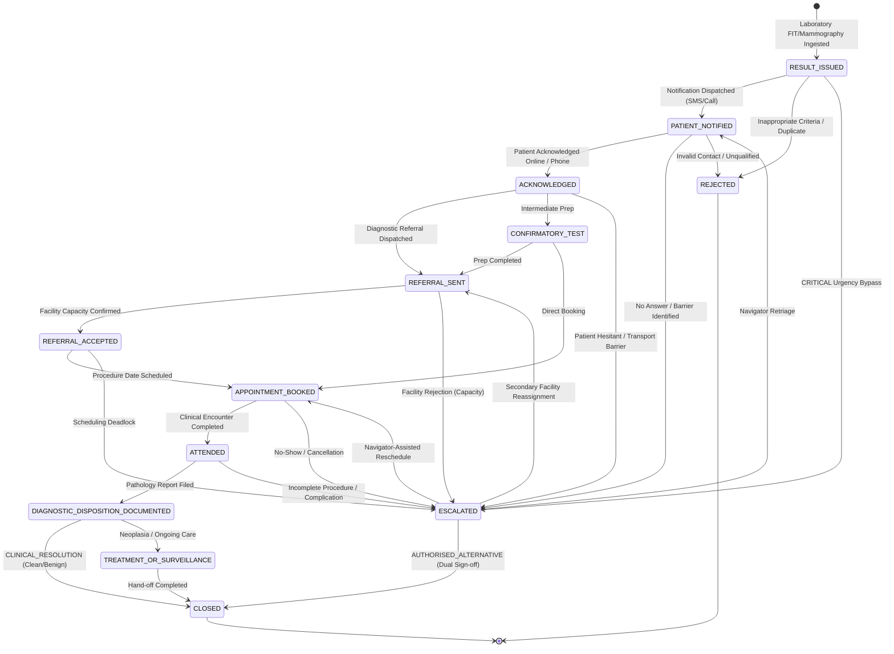

# CareLoop Case State Model & Clinical Workflow Specification

> **ETHICAL & REGULATORY NOTICE**:
> CareLoop is an innovation prototype and does not make claims of regulatory or clinical compliance. All data depicted is 100% synthetic.

---

## 1. Executive Summary

The CareLoop closed-loop screening architecture ensures that no abnormal cancer screening result is lost to follow-up. In accordance with clinical trial evidence and healthcare delivery reality, the system enforces a fundamental invariant:

$$\text{Delivery} \neq \text{Acknowledgement} \neq \text{Understanding}$$
$$\text{Booked} \neq \text{Attended} \neq \text{Resolved}$$

A screening encounter is never considered complete when an SMS is sent, when a specialist referral is dispatched, or when an appointment is scheduled. Closure requires verifiable clinical evidence of diagnostic disposition or an independently authorized alternative clinical rationale signed off by a licensed clinician.

---

## 2. Complete State Enumeration

The lifecycle of every screening finding is tracked across **13 discrete, immutable states**:

| State | Classification | Description |
| :--- | :--- | :--- |
| `RESULT_ISSUED` | Initial | Laboratory or clinic feed ingested positive/abnormal result. Uncontacted. |
| `PATIENT_NOTIFIED` | In-Flight | Automated or manual outreach dispatched via SMS, WhatsApp, or phone. |
| `ACKNOWLEDGED` | In-Flight | Patient opened secure link, confirmed receipt, or spoke to a navigator. |
| `CONFIRMATORY_TEST` | In-Flight | Intermediate preparatory milestone (e.g. repeat test or bowel prep verification). |
| `REFERRAL_SENT` | In-Flight | Diagnostic referral dispatched to specialized endoscopy or imaging center. |
| `REFERRAL_ACCEPTED` | In-Flight | Receiving diagnostic center confirmed capacity and accepted patient transfer. |
| `APPOINTMENT_BOOKED` | In-Flight | Specific date and time confirmed on diagnostic calendar. |
| `ATTENDED` | In-Flight | Patient completed diagnostic examination encounter (colonoscopy/biopsy). |
| `DIAGNOSTIC_DISPOSITION_DOCUMENTED` | Pre-Closure | Pathology report and definitive diagnostic disposition filed in EHR/HIE. |
| `TREATMENT_OR_SURVEILLANCE` | Ongoing | Patient enrolled in post-diagnostic longitudinal surveillance or oncology care. |
| `CLOSED` | Terminal | Care loop resolved with clinical evidence or dual-authorized alternative. |
| `REJECTED` | Terminal / Exception | Screening result rejected due to sample failure, duplicate, or wrong criteria. |
| `ESCALATED` | High-Attention | Case breached SLA, experienced severe barriers, or received CRITICAL flag. |

---

## 3. State Transition Graph (Mermaid)

---

## 4. Role Authorization Matrix

Every state transition requires a named actor and authenticated role (`x-user-role`). The platform enforces fail-closed authorization:

| Transition Target | `PATIENT` | `NAVIGATOR` | `CLINICIAN` | `PROGRAMME_ANALYST` |
| :--- | :---: | :---: | :---: | :---: |
| `PATIENT_NOTIFIED` | ❌ | ✅ | ✅ | ❌ (Read-only) |
| `ACKNOWLEDGED` | ✅ | ✅ | ✅ | ❌ |
| `REFERRAL_SENT` | ❌ | ✅ | ✅ | ❌ |
| `REFERRAL_ACCEPTED`| ❌ | ✅ | ✅ | ❌ |
| `APPOINTMENT_BOOKED`| ✅ (Self-book) | ✅ | ✅ | ❌ |
| `ATTENDED` | ❌ | ❌ | ✅ | ❌ |
| `DIAGNOSTIC_DISPOSITION` | ❌ | ❌ | ✅ | ❌ |
| `TREATMENT_SURVEILLANCE` | ❌ | ✅ | ✅ | ❌ |
| `ESCALATED` | ✅ (Decline/Hesitant) | ✅ | ✅ | ✅ (Demo Clock) |
| `CLOSED` (Clinical) | ❌ | ❌ | ✅ (Requires Evidence) | ❌ |
| `CLOSED` (Alternative)| ❌ | ❌ (Request only) | ✅ (Dual Sign-off) | ❌ |
| `REJECTED` | ❌ | ✅ | ✅ | ❌ |

---

## 5. Strict Closure Governance

A case cannot be arbitrarily closed. The platform strictly enforces two mutual pathways to `CLOSED`:

### Path A: `CLINICAL_RESOLUTION`
- **Permitted Role**: `CLINICIAN` only.
- **Mandatory Preconditions**:
  1. Milestones `diagnosticDispositionDocumentedAt` or current state `DIAGNOSTIC_DISPOSITION_DOCUMENTED`.
  2. Non-empty `clinicalEvidenceRef` (e.g. histopathology report accession number, endoscopy imaging record ID).
  3. Clinical explanatory closure note.

### Path B: `AUTHORISED_ALTERNATIVE`
- **Permitted Roles**: Two-party protocol (`Navigator Requests` $\to$ `Clinician Authorises`).
- **Mandatory Preconditions**:
  1. Named `requesterId` (Care Navigator who identified barrier).
  2. Named `authoriserId` (`CLINICIAN` independent of requester).
  3. **Strict Separation of Duties**: `requesterId !== authoriserId` (preventing unilateral closure).
  4. Explicit clinical reason code:
     - `INFORMED_REFUSAL`: Patient provided informed refusal after counseling.
     - `TRANSFERRED_CARE`: Patient transferred care to private network or relocated.
     - `DECEASED`: Patient deceased.
     - `UNREACHABLE_AFTER_CONFIGURED_ATTEMPTS`: Patient exhausted multi-tier contact ladder (SMS $\to$ 2 Calls $\to$ In-person visit).
     - `OTHER`: Exceptional circumstances with narrative justification.
  5. Explanatory note (minimum 5 characters).

---

## 6. System Invariants & Anti-Patterns Prevented

1. **Anti-Pattern: "Closed on Notification"**: Sending an outreach message does not resolve screening. Attempting to transition from `RESULT_ISSUED` directly to `CLOSED` is rejected by the state engine.
2. **Anti-Pattern: "Closed on Referral"**: Generating a referral order without confirmed acceptance, attendance, and disposition is rejected.
3. **Anti-Pattern: "Closed on Booking"**: Scheduling an appointment without confirmed attendance and pathology verification cannot close a case.
4. **Anti-Pattern: Unilateral Closure**: A navigator cannot close a case without independent clinician authorization; a clinician cannot authorize their own closure request without documented evidence.
