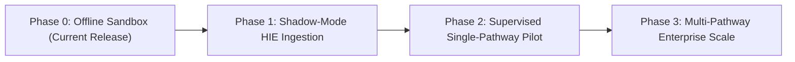

# CareLoop Phased Clinical Pilot & Health System Integration Roadmap

> **PILOT NOTICE**:
> CareLoop is an innovation platform. Transition to live clinical operations requires regulatory review by the Department of Health – Abu Dhabi (DoH), Malaffi integration agreements, and IRB / ethics approval.

---

## 1. Overview & Phased Deployment Strategy

To safely transition from an offline demonstrator to an enterprise health system asset, CareLoop utilizes a **4-stage progressive pilot framework**. Each phase has strict entry criteria, safety gates, and quantifiable success metrics.

---

## 2. Phase Breakdown & Safety Gates

### Phase 0: Offline Sandbox & Simulation Validation (Current Release)
- **Objective**: Verify architectural invariants, deterministic seeder, cryptographic audit chain, and human-in-the-loop AI governance using synthetic data.
- **Environment**: Standalone containerized deployment, zero external connectivity.
- **Milestones**:
  - 100% passing test suite across state machine, SLA engine, and RBAC rules.
  - Verification of small-cell suppression (<10) and fair outcome monitoring.
  - Zero real PHI in the code repository or database stores.

### Phase 1: Observational "Shadow-Mode" Integration (60 Days)
- **Objective**: Ingest live laboratory screening feeds (e.g. FIT results from SEHA and private lab networks) in read-only mode to evaluate drop-off predictions against standard care.
- **Integration**:
  - Direct read-only connection to **Malaffi (Abu Dhabi HIE)** via FHIR R4 `DiagnosticReport` and `Observation` endpoints.
  - UAE Pass authentication for navigators and clinicians.
- **Safety Gate**:
  - CareLoop runs entirely in parallel; navigators view cases but **do not dispatch outreach**.
  - Baseline concordance analysis: verify that predicted drop-offs match empirical loss-to-follow-up without interfering with current care pathways.

### Phase 2: Supervised Single-Pathway Navigator Pilot (90 Days)
- **Objective**: Active intervention on a single high-burden pathway (**Colorectal Cancer Screening / Positive FIT** across 2 pilot diagnostic centers).
- **Intervention**:
  - Active multi-channel ladder (bilingual Arabic/English SMS, WhatsApp, voice calls).
  - Dedicated navigator worklist with human-approved AI templates.
  - Central diagnostic transfer management with receiving endoscopy pavilion.
- **Safety Controls**:
  - Dual clinician sign-off on all alternative closures.
  - Real-time SLA breach alerting for cases approaching 31 working days.
- **Key Performance Indicators (KPIs)**:
  - Time-to-colonoscopy reduction from baseline.
  - Patient satisfaction and comprehension score on bilingual results.
  - Disparity gap reduction between Emirati and expatriate cohorts.

### Phase 3: Multi-Pathway Enterprise Expansion (180 Days)
- **Objective**: Full rollout across Colorectal, Breast, and Cervical screening networks in Abu Dhabi emirate.
- **Capabilities**:
  - Multi-facility load balancing and automated referral reassignment for capacity constraints.
  - Cryptographic audit trail integration with DoH regulatory dashboards.
  - Longitudinal surveillance cohort enrollment (`TREATMENT_OR_SURVEILLANCE`).

---

## 3. Technical & Governance Prerequisites for Live Deployment

1. **Information Security & Data Residency**:
   - Compliance with UAE Federal Decree-Law No. 45/2021 on Personal Data Protection.
   - Hosting on UAE sovereign cloud infrastructure (e.g. Core42 / G42 Cloud / Microsoft UAE Central).
2. **Clinical Governance & Dual Authorization**:
   - Institutional approval of navigator phone scripts and bilingual educational content by DoH Public Health Committee.
   - Multi-factor authentication (MFA) and hardware token verification for clinician closure sign-offs.
3. **Interoperability Standards**:
   - Full conformance testing against Malaffi Implementation Guides (FHIR R4 US Core / UAE Core profiles).
   - HL7 v2 / FHIR REST translation layer for non-digital ambulatory facilities.
